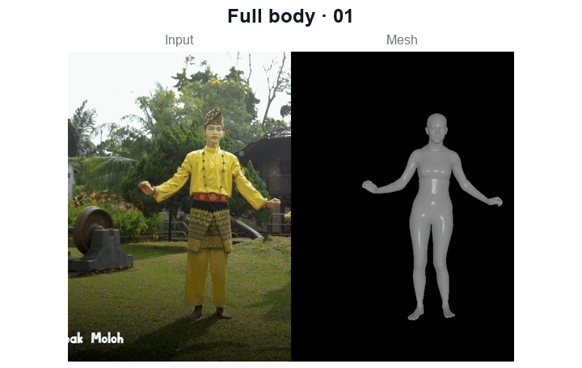
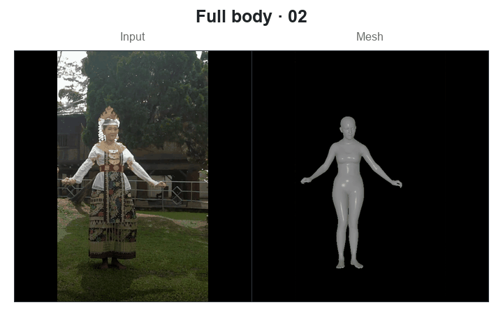
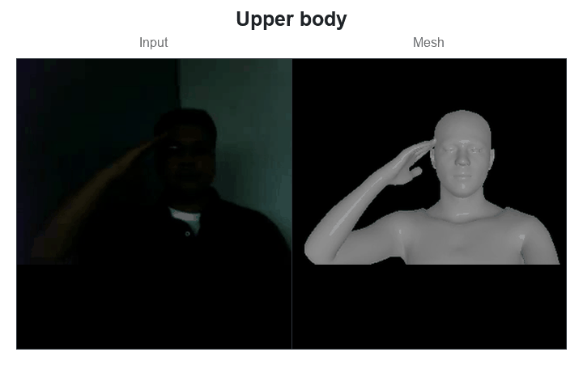
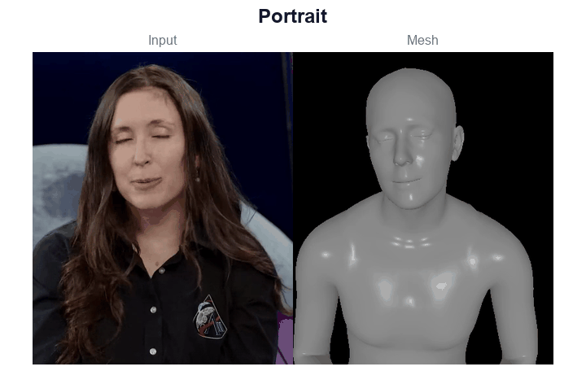
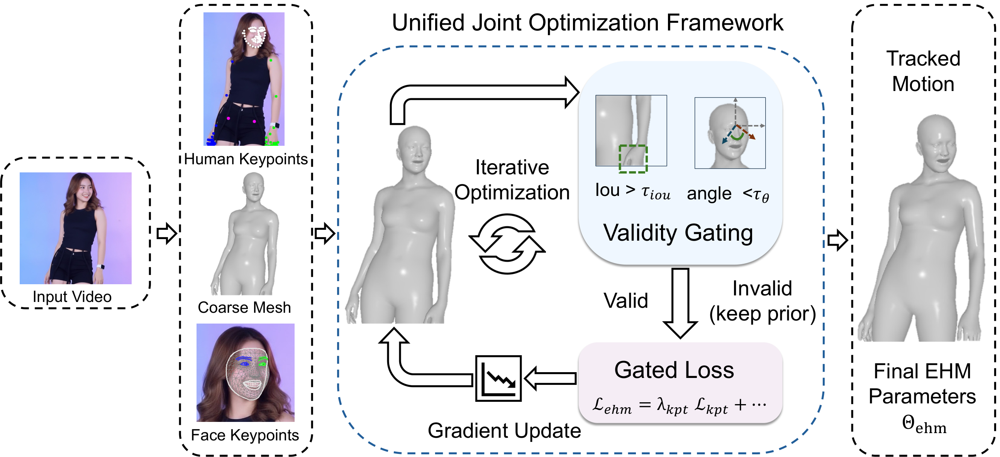

<div align="center">

# EMOSH-Tracker

### Official Human Tracking Implementation for EMOSH (ECCV 2026)

Tracks expressive body, hand, and face motion from full-body, upper-body, and portrait images or videos, with joint fitting and flexible input resolutions.

<p>
  <a href="https://eastbeanzhang.github.io/EMOSH/"></a>
  <a href="https://arxiv.org/abs/2606.28026"></a>
  <a href="https://www.youtube.com/watch?v=u_C6ugqoNKM"></a>
  <a href="https://github.com/EastbeanZhang/EMOSH"></a>
  <a href="https://github.com/Pixel-Talk/EHM-Tracker"></a>
</p>

</div>

<p align="center">
  <a href="assets/previews/full_body_motion.gif"></a>
  <a href="assets/previews/full_body_motion_2.gif"></a>
</p>
<p align="center">
  <a href="assets/previews/upper_body_motion.gif"></a>
  <a href="assets/previews/head_motion.gif"></a>
</p>

**Input → mesh.** Two full-body examples, upper-body motion, and a portrait, tracked with the default 1,251 fitting steps. Click a preview for the full **input | mesh | overlay** animation. [Media sources and licenses](assets/PROVENANCE.md).

## From EHM-Tracker to EMOSH-Tracker

1. **Better tracking across scenes.** More reliable full-body, upper-body, and portrait fitting, including occlusions and large head rotations.
2. **Faster fitting.** Approximately **1.9×** faster on the same 436-frame video: **223 s** versus **424 s** for GUAVA/EHM-Tracker.
3. **Flexible input resolutions.** Supports square, portrait, and landscape inputs at native or custom resolutions, preserving aspect ratio and output dimensions.

[Method and comparison details](docs/comparison.md) · [Runtime options and limitations](docs/running.md)

## Pipeline



GVHMR, HaMeR, and TEASER initialize body, hands, and face. DWPose and dense facial landmarks provide 2D guidance; gated joint optimization refines the EHM parameters with pose priors, 3D hand alignment, and temporal regularization.

## Get started

**Linux + NVIDIA CUDA GPU · Python 3.10.** The verified isolated environment uses PyTorch 2.9.1/CUDA 13.0 and PyTorch3D 0.7.9.

**GPU memory:** approximately **10.70 GiB sampled process peak** on a **15-second, 450-frame 1920×1080 video at 30 FPS** (`--head-only`, 32-frame windows, 1,251 steps per window). [Memory usage](docs/running.md#memory-usage).

1. Follow [installation](docs/installation.md) to create the environment and install the pinned dependencies.
2. Download the licensed models using the [file list and official download links](docs/models.md).
3. Download auxiliary files and check the asset layout:

```bash
python scripts/download_support.py
python track.py --check-assets
```

### Track an image or video

```bash
# Full-body image
python track.py --input assets/examples/full_body.jpg \
  --output results/images --visualize

# Full-body videos
python track.py --input assets/examples/full_body_motion.mp4 assets/examples/full_body_motion_2.mp4 \
  --output results/videos --visualize

# Portrait and cropped upper-body videos
python track.py --input assets/examples/head_motion.mp4 assets/examples/upper_body_motion.mp4 \
  --output results/videos --head-only --visualize

# All seven bundled image/video examples
bash scripts/run_examples.sh
```

Use **`--head-only` for portraits and upper-body crops with unobserved limbs**. This objective still exports a complete EHM mesh. The default body objective can inherit an incorrect arm pose in tightly cropped scenes.

Each input produces motion/camera parameters (`optim_tracking.npy`), shared identity (`id_share_params.npy`), initialization data, and completion metadata. `--visualize` adds `tracking.png` or `tracking.mp4`; `--save-images` adds per-frame input/mesh/overlay PNGs. [Output conventions](docs/outputs.md) · [Runtime and memory options](docs/running.md).

### Choose a resolution

Source dimensions are retained by default. `--target-size WIDTH HEIGHT` uniformly fits the complete image onto a centered, padded canvas:

```bash
python track.py --input assets/examples/full_body_motion.mp4 \
  --output results/portrait_canvas --target-size 360 640 --visualize

python track.py --input assets/examples/head_motion.mp4 \
  --output results/odd_canvas --target-size 641 479 --head-only --visualize
```

The person is never stretched or cropped to fill the canvas. Initializer networks retain their fixed-size internal crops; predictions and cameras map back to the selected canvas and source image. Odd-sized videos use H.264 4:4:4; per-frame PNGs are also available.

## Training data for EMOSH

Export tracked frames with `--save-images`, then use EMOSH's dataset converter and training code. The [video-to-training workflow](docs/training-data.md) covers packing records, held-out splits and different image dimensions.

## Acknowledgements and terms

Built on [EHM-Tracker / GUAVA](https://github.com/Pixel-Talk/EHM-Tracker), [GVHMR](https://github.com/zju3dv/GVHMR), [HaMeR](https://github.com/geopavlakos/hamer), [TEASER](https://github.com/Pixel-Talk/TEASER), [DWPose](https://github.com/IDEA-Research/DWPose), [SMPL-X](https://smpl-x.is.tue.mpg.de/), [FLAME](https://flame.is.tue.mpg.de/), [MANO](https://mano.is.tue.mpg.de/), MediaPipe, ViTPose, and PyTorch3D.

Project-authored code is [Apache-2.0](LICENSE). Third-party components and separately downloaded models retain their own terms, including GVHMR's research/non-commercial restrictions and the SMPL-X/FLAME/MANO agreements. See [third-party notices](THIRD_PARTY_NOTICES.md) and [example media licenses](assets/PROVENANCE.md).

## Citation

```bibtex
@inproceedings{zhang2026emosh,
  title={EMOSH: Expressive Motion and Shape Disentanglement for Human Animation},
  author={Zhang, Dongbin and Liu, Hao and Dai, Binquan and Chen, Kangjie and Wang, Chuming and Li, Chen and Lyu, Jing and Wang, Haoqian},
  booktitle={European Conference on Computer Vision (ECCV)},
  year={2026}
}
```
