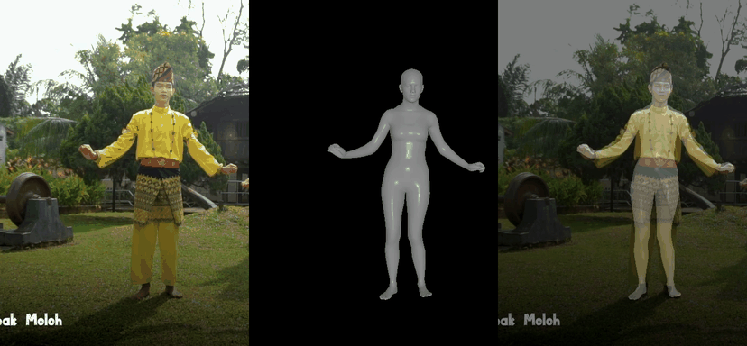
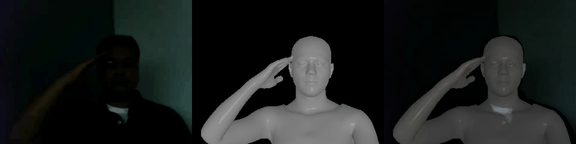
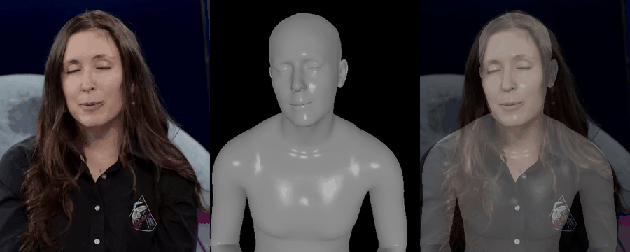

<div align="center">

# EMOSH-Tracker

### Expressive human tracking across full-body, upper-body, and portrait scenes

**[EMOSH · ECCV 2026](https://arxiv.org/abs/2606.28026)**

[Project Page](https://eastbeanzhang.github.io/EMOSH/) · [Paper](https://arxiv.org/abs/2606.28026) · [Installation](docs/installation.md) · [Models](docs/models.md)

</div>

EMOSH-Tracker recovers **body pose, articulated hands, facial expression, identity shape, and camera parameters** from single-person images and videos. It builds on [EHM-Tracker](https://github.com/Pixel-Talk/EHM-Tracker), released with GUAVA, using the joint fitting framework introduced in EMOSH.

### Full body

<p align="center">
  
</p>

### Upper body

<p align="center">
  
</p>

### Portrait

<p align="center">
  
</p>

**Input → mesh → overlay.** Actual outputs from the bundled videos at the default 1,251 fitting steps; GIFs are resized and frame-sampled. [Media sources and licenses](assets/PROVENANCE.md).

## From EHM-Tracker to EMOSH-Tracker

- **Unified fitting.** Jointly optimize body, hands, face, identity, and camera parameters, replacing GUAVA's cascaded facial-then-body fitting.
- **Visibility-aware tracking.** Confidence-aware Validity Gating filters unreliable face/hand guidance and falls back to priors under occlusion or large head rotations. The paper compares full-body, half-body, and close-up scenes, showing fewer foot/hand deviations, hallucinated occluded arms, and close-up failures.
- **Faster fitting in the paper's comparison.** On the same 436-frame video, EMOSH takes **223 s (1.96 FPS)** versus GUAVA's **424 s (1.03 FPS)**: approximately **1.9×** faster. These are the paper's measurements; release timings depend on input and hardware.
- **Flexible image geometry in this release.** Native dimensions or a custom **width × height**, with aspect-preserving fitting, explicit camera transforms, exact odd-sized exports, and preserved frame coverage/FPS.
- **A focused inference release.** One image/video CLI, checked model files, an isolated installation recipe, and runnable examples for all three scene types.

[Method and comparison details](docs/comparison.md) · [Release validation](docs/validation.md)

## Pipeline


GVHMR, HaMeR, and TEASER initialize body, hands, and face. DWPose and dense facial landmarks provide 2D guidance; gated joint optimization refines the EHM parameters with pose priors, 3D hand alignment, and temporal regularization.

[Original vector figure (PDF)](assets/docs/motion_tracker_pipeline.pdf) · [Paper results (PDF)](assets/docs/show_tracking.pdf)

## Get started

**Linux + NVIDIA CUDA GPU · Python 3.10.** The verified isolated environment uses PyTorch 2.9.1/CUDA 13.0 and PyTorch3D 0.7.9. Tested examples peaked at **8.23 GiB allocated / 8.50 GiB reserved**; leave additional GPU memory headroom.

1. Follow [installation](docs/installation.md) to create the environment and install the pinned dependencies.
2. Download the licensed models using the [file list and official download links](docs/models.md).
3. Download auxiliary files and check the asset layout:

```bash
python scripts/download_support.py
python track.py --check-assets
```

### Track an image or video

```bash
# Full-body image
python track.py --input assets/examples/full_body.jpg \
  --output results/images --visualize

# Full-body video
python track.py --input assets/examples/full_body_motion.mp4 \
  --output results/videos --visualize

# Portrait and cropped upper-body videos
python track.py --input assets/examples/head_motion.mp4 assets/examples/upper_body_motion.mp4 \
  --output results/videos --head-only --visualize

# All six bundled image/video examples
bash scripts/run_examples.sh
```

Use **`--head-only` for portraits and upper-body crops with unobserved limbs**. This objective still exports a complete EHM mesh. The default body objective can inherit an incorrect arm pose in tightly cropped scenes.

Each input produces motion/camera parameters (`optim_tracking.npy`), shared identity (`id_share_params.npy`), initialization data, and completion metadata. `--visualize` adds `tracking.png` or `tracking.mp4`; `--save-images` adds per-frame input/mesh/overlay PNGs. [Output conventions](docs/outputs.md) · [Runtime and memory options](docs/running.md).

### Choose a resolution

Source dimensions are retained by default. `--target-size WIDTH HEIGHT` uniformly fits the complete image onto a centered, padded canvas:

```bash
python track.py --input assets/examples/full_body_motion.mp4 \
  --output results/portrait_canvas --target-size 360 640 --visualize

python track.py --input assets/examples/head_motion.mp4 \
  --output results/odd_canvas --target-size 641 479 --head-only --visualize
```

The person is never stretched or cropped to fill the canvas. Initializer networks retain their fixed-size internal crops; predictions and cameras map back to the selected canvas and source image. Odd-sized videos use H.264 4:4:4; per-frame PNGs are also available.

## Verified release

**105 tests passed with no skips**, including CUDA rendering and real EHM decoder checks. All **36/36 tracking cases** passed across six canvases: **512×512, 640×360, 360×640, 832×480, 641×479, and 1920×1080**. All six examples also passed at native size, including three complete 48-frame videos.

The matrix uses the default 1,251 fitting steps and eight frames per video case. It checks finite parameters, camera transforms, frame indices, FPS, and exact export dimensions. [Results and limitations](docs/validation.md) · [Machine-readable record](docs/resolution_validation.json).

```bash
python -m pip install -r requirements-dev.txt
python -m pytest -q tests
ruff check .
python scripts/validate_resolutions.py --max-frames 8 --steps 1251 --fail-fast
```

Tracking quality depends on visible detail, motion, and occlusion. Fitting windows share identity but have no temporal loss across their boundaries. See [runtime notes](docs/running.md) before processing long clips.

## Acknowledgements and terms

Built on [EHM-Tracker / GUAVA](https://github.com/Pixel-Talk/EHM-Tracker), [GVHMR](https://github.com/zju3dv/GVHMR), [HaMeR](https://github.com/geopavlakos/hamer), [TEASER](https://github.com/Pixel-Talk/TEASER), [DWPose](https://github.com/IDEA-Research/DWPose), [SMPL-X](https://smpl-x.is.tue.mpg.de/), [FLAME](https://flame.is.tue.mpg.de/), [MANO](https://mano.is.tue.mpg.de/), MediaPipe, ViTPose, and PyTorch3D.

Project-authored code is [Apache-2.0](LICENSE). Third-party components and separately downloaded models retain their own terms, including GVHMR's research/non-commercial restrictions and the SMPL-X/FLAME/MANO agreements. See [third-party notices](THIRD_PARTY_NOTICES.md) and [example media licenses](assets/PROVENANCE.md).

## Citation

```bibtex
@inproceedings{zhang2026emosh,
  title={EMOSH: Expressive Motion and Shape Disentanglement for Human Animation},
  author={Zhang, Dongbin and Liu, Hao and Dai, Binquan and Chen, Kangjie and Wang, Chuming and Li, Chen and Lyu, Jing and Wang, Haoqian},
  booktitle={European Conference on Computer Vision (ECCV)},
  year={2026}
}
```
